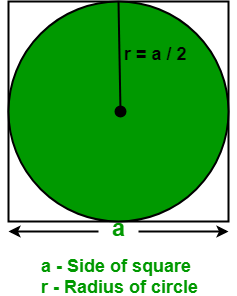

# Ασκήσεις με πιθανότητες

[:material-file-pdf-box: Εκτυπώσιμο PDF](lesson-04.pdf){ .md-button }

!!! note "Σχετική θεωρία"
    [Μάθημα 4 — Οι βιβλιοθήκες time και random](../theory/lesson-04.md)

## Άσκηση 1

Φτιάξε ένα ζάρι που ρίχνει 6 με πιθανότητα ½.

## Άσκηση 2

Φτιάξε ένα πρόγραμμα που ρίχνει ζάρια — εδώ δίκαια ζάρια, όχι το πειραγμένο της
άσκησης 1. Το πρόγραμμα πρέπει να τερματίζει όταν έρθουν έξι εξάρια στη σειρά.
Υπολόγισε πόσες ρίψεις χρειάστηκαν για να γίνει αυτό. Εκτύπωσε, επίσης, τον
χρόνο που χρειάστηκε για να γίνει αυτό.

## Άσκηση 3

Μετέφερε το προηγούμενο πρόγραμμα σε μία συνάρτηση και κάνε 5000 πειράματα για
να υπολογίσεις το μέσο αριθμό ρίψεων που χρειάζεται για να έρθουν 6 εξάρια στη
σειρά.

## Άσκηση 4

Ρίχνουμε 10000 φορές ένα κέρμα. Στο τέλος του πειράματος υπολογίζουμε τα ποσοστά
κορώνας και γραμμάτων. Επαναλαμβάνουμε το πείραμα 10000 φορές και υπολογίζουμε
τον μέσο όρο των ποσοστών. Σκοπός του πειράματος είναι το τελικό αποτέλεσμα να
αντικατοπτρίζει την πιθανότητα να τύχει κορώνα ή γράμματα.

## Άσκηση 5

Ένας άνθρωπος αποφασίζει να στοιχηματίσει 100 ευρώ σε κορώνα-γράμματα. Κάθε
φορά που μαντεύει σωστά κερδίζει 1 ευρώ, ενώ όταν χάνει, χάνει 1 ευρώ. Θα
σταματήσει είτε όταν χάσει όλα του τα χρήματα είτε όταν τα χρήματά του φτάσουν
τα 200 ευρώ. Φτιάξτε ένα πρόγραμμα που προσομοιώνει το παιχνίδι του.

## Άσκηση 6

Υπολόγισε πειραματικά το π. Φτιάξε ένα τετράγωνο που έχει εγγεγραμμένο κύκλο.
Πετάμε βελάκια (τυχαία). Μετράμε πόσα βελάκια πέφτουν μέσα στον κύκλο.
Υπολόγισε τον λόγο των βελακίων που πέφτουν μέσα στον κύκλο δια τον συνολικό
αριθμό. Με τι είναι ίσος αυτός ο λόγος;

{ width="180" }

## Άσκηση 7

Ποια είναι η πιθανότητα να τραβήξουμε 4 άσσους στη σειρά από μια ανακατεμένη
τράπουλα; Υπολογίστε την πρώτα θεωρητικά. Έπειτα επιβεβαιώστε την πειραματικά:
ανακατέψτε την τράπουλα 10000000 φορές και μετρήστε σε πόσες από αυτές έρχονται
4 άσσοι στη σειρά.

!!! note "Σημείωση"
    Το πρόγραμμα θα χρειαστεί περίπου ένα λεπτό για να τελειώσει. Μην
    ανησυχήσετε αν φαίνεται ότι «κόλλησε».

??? tip "Ψάξε μόνος σου"
    - [docs.python.org — `random`](https://docs.python.org/3/library/random.html)
    - [docs.python.org — `time.time()`](https://docs.python.org/3/library/time.html#time.time)
    - [docs.python.org — Defining Functions](https://docs.python.org/3/tutorial/controlflow.html#defining-functions)
