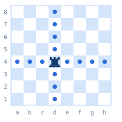

# Δύσκολες ασκήσεις if / else

[:material-file-pdf-box: Εκτυπώσιμο PDF](lesson-03-hard.pdf){ .md-button }

!!! note "Σχετική θεωρία"
    [Μάθημα 3 — booleans, τελεστές, if / elif / else, match](../theory/lesson-03.md)

    Ξεκινήστε από τις [απλές ασκήσεις if / else](lesson-03.md) αν δεν τις έχετε λύσει ακόμα.

## Ερωτήσεις θεωρίας: βρείτε το λάθος

### Ερώτηση 1

Ένα κατάστημα δίνει έκπτωση 5% για αγορές άνω των 50 ευρώ, 10% για αγορές άνω
των 100 ευρώ και 20% για αγορές άνω των 200 ευρώ. Ο προγραμματιστής έγραψε τον
παρακάτω κώδικα, αλλά οι πελάτες παραπονιούνται.

```python
amount = int(input("ποσό:"))

if amount > 50:
    print("Έκπτωση 5%")
elif amount > 100:
    print("Έκπτωση 10%")
elif amount > 200:
    print("Έκπτωση 20%")
else:
    print("Καμία έκπτωση")
```

- Τι θα εμφανίσει το πρόγραμμα για ποσό 250; (Απαντήστε χωρίς υπολογιστή.)
- Γιατί συμβαίνει αυτό; Ποια μηνύματα δεν θα εμφανιστούν **ποτέ**, ό,τι ποσό κι
  αν δώσουμε;
- Διορθώστε το πρόγραμμα **χωρίς να αλλάξετε καμία συνθήκη**.

### Ερώτηση 2

Το παρακάτω πρόγραμμα αφορά τη δυνατότητα συμμετοχής σε ένα ταξίδι για παιδιά
γυμνασίου και λυκείου.

```python
age = int(input("Ηλικία: "))

if age >= 12 or age <= 18:
    print("Επιτρέπεται η συμμετοχή")
else:
    print("Δεν επιτρέπεται")
```

- Τι λάθος έχει γίνει; Πώς θα το διορθώνατε;

## Ασκήσεις

### Άσκηση 1

Γράψτε ένα πρόγραμμα που δέχεται ως είσοδο τον αριθμό ενός μήνα και εμφανίζει σε
ποια εποχή ανήκει (Χειμώνας, Άνοιξη, Καλοκαίρι, Φθινόπωρο). Αν ο αριθμός δεν
αντιστοιχεί σε έγκυρο μήνα, τότε να εμφανίζεται το μήνυμα “άκυρος μήνας”.

```screen title="Παράδειγμα εξόδου για έγκυρο μήνα"
μήνας:{{4}}
Άνοιξη
```

```screen title="Παράδειγμα εξόδου για άκυρο μήνα"
μήνας:{{13}}
άκυρος μήνας
```

### Άσκηση 2

Φτιάξτε μια αριθμομηχανή. Πρέπει να δέχεται δύο αριθμούς και το σύμβολο της
επιθυμητής πράξης από τον χρήστη και να εμφανίζει το αποτέλεσμα. Για τον
πολλαπλασιασμό, πρέπει να αναγνωρίζει τα σύμβολα “x” και “*”. Αν το σύμβολο είναι
άκυρο ή η πράξη είναι απαγορευμένη, πρέπει να ενημερώνει τον χρήστη.

```screen title="Παράδειγμα εξόδου"
πρώτος αριθμός:{{6}}
δεύτερος αριθμός:{{7}}
πράξη:{{x}}
42
```

```screen title="Παράδειγμα εξόδου για άκυρο σύμβολο"
πρώτος αριθμός:{{6}}
δεύτερος αριθμός:{{7}}
πράξη:{{#}}
Άκυρο σύμβολο
```

### Άσκηση 3

Γράψτε ένα πρόγραμμα που δέχεται τρεις λέξεις από τον χρήστη, με μικρά λατινικά
γράμματα. Το πρόγραμμα πρέπει να τυπώνει τη λέξη που θα βρίσκαμε πρώτη σε ένα
λεξικό.

```screen title="Παράδειγμα εξόδου"
1η λέξη:{{pear}}
2η λέξη:{{apple}}
3η λέξη:{{mango}}
apple
```

### Άσκηση 4

Δημιουργήθηκε μια εταιρεία που παρέχει απεριόριστη ζεστή σοκολάτα στη βρύση σας.
Χρεώνει κλιμακωτά. Κάθε λογαριασμός έχει πάγιο κόστος 5 ευρώ και επιπλέον:

- τα πρώτα 100 λίτρα κοστίζουν 0.1 ευρώ το καθένα,
- τα επόμενα 200 λίτρα (από 101 ως 300) κοστίζουν 0.2 ευρώ το καθένα,
- όσα λίτρα ξεπερνούν τα 300 κοστίζουν 0.5 ευρώ το καθένα.

Γράψτε πρόγραμμα που δέχεται την κατανάλωση και εμφανίζει τον λογαριασμό. Αν η
κατανάλωση είναι αρνητική, εμφανίζει “Μη έγκυρη τιμή”.

```screen title="Παράδειγμα εξόδου"
κατανάλωση (λίτρα):{{350}}
Λογαριασμός: 80.0 ευρώ
```

### Άσκηση 5

Στο λούνα παρκ, στο “Τρενάκι του τρόμου” μπορεί να ανέβει κάποιος μόνο αν έχει
ύψος τουλάχιστον 140 cm. Το πρόγραμμα ζητά το ύψος και την ηλικία του επισκέπτη.
Αν είναι κάτω των 12 ετών, ρωτάει επιπλέον αν έχει συνοδό (“ναι”/“όχι”). Η
ερώτηση αυτή γίνεται **μόνο** στα παιδιά κάτω των 12. Χωρίς συνοδό, το παιδί δεν
μπορεί να ανέβει.

Αν επιτρέπεται να ανέβει, το εισιτήριο κοστίζει 5 ευρώ για όσους είναι κάτω των 12
ή από 65 ετών και πάνω, και 10 ευρώ για όλους τους άλλους. Αν δεν επιτρέπεται,
εμφανίζει “Δεν μπορείς να ανέβεις”.

```screen title="Παράδειγμα εξόδου για παιδί κάτω των 12"
ύψος (cm):{{145}}
ηλικία:{{10}}
συνοδός;{{ναι}}
Το εισιτήριο κοστίζει 5 ευρώ
```

```screen title="Παράδειγμα εξόδου για ενήλικα (δεν γίνεται η ερώτηση για συνοδό)"
ύψος (cm):{{150}}
ηλικία:{{30}}
Το εισιτήριο κοστίζει 10 ευρώ
```

### Άσκηση 6

Φτιάξτε ένα πρόγραμμα που δέχεται την αρχική και την τελική θέση ενός πύργου σε
μια άδεια σκακιέρα (πριν και μετά από μια κίνηση). Η θέση περιγράφεται από τη
στήλη (γράμμα a έως h) και τη γραμμή (αριθμός 1 έως 8). Πρέπει να ελέγχεται αν οι
θέσεις είναι έγκυρες και αν η τελική θέση είναι σωστή. Ο πύργος κινείται είτε
οριζόντια είτε κάθετα.

<figure markdown>
  { width="220" }
  <figcaption>Ο πύργος στη θέση d4 μπορεί να μετακινηθεί σε όποιο τετράγωνο έχει κουκκίδα.</figcaption>
</figure>

```screen title="Παράδειγμα εξόδου για σωστή κίνηση"
αρχική στήλη:{{d}}
αρχική γραμμή:{{4}}
τελική στήλη:{{d}}
τελική γραμμή:{{8}}
Σωστή κίνηση
```

```screen title="Παράδειγμα εξόδου για λάθος κίνηση"
αρχική στήλη:{{d}}
αρχική γραμμή:{{4}}
τελική στήλη:{{f}}
τελική γραμμή:{{6}}
Λάθος κίνηση
```

### Άσκηση 7

Γράψτε ένα πρόγραμμα που δέχεται ως είσοδο μια ημερομηνία (μέρα, μήνα και έτος) και
εμφανίζει αν είναι έγκυρη. Πρέπει να λαμβάνεται υπόψη το αν ένα έτος είναι
δίσεκτο. Σε αυτή την περίπτωση, ο Φεβρουάριος έχει 29 ημέρες αντί για 28.

Ένα έτος είναι δίσεκτο αν διαιρείται με το 4 αλλά **όχι** με το 100. Υπάρχει όμως
μια εξαίρεση: αν διαιρείται με το 400, είναι **πάντα** δίσεκτο. Για παράδειγμα, το
2000 ήταν δίσεκτο, ενώ το 1900 δεν ήταν.

```screen title="Παράδειγμα εξόδου για έγκυρη ημερομηνία"
μέρα:{{29}}
μήνας:{{2}}
έτος:{{2000}}
Έγκυρη ημερομηνία
```

```screen title="Παράδειγμα εξόδου για μη έγκυρη ημερομηνία"
μέρα:{{29}}
μήνας:{{2}}
έτος:{{1900}}
Μη έγκυρη ημερομηνία
```

### Άσκηση 8

Γράψτε πρόγραμμα που ζητά την ηλικία και αν ο χρήστης είναι φοιτητής (“ναι”/“όχι”)
και εμφανίζει το κόστος του εισιτηρίου:

- κάτω από 18 ➜ 5€
- από 18 ως 64 και φοιτητής ➜ 6€
- από 18 ως 64 και όχι φοιτητής ➜ 10€
- από 65 και πάνω ➜ 4€

```screen title="Παράδειγμα εξόδου"
ηλικία:{{20}}
φοιτητής;{{ναι}}
Κόστος 6€
```

### Άσκηση 9

Το πρόγραμμα ρωτάει τον χρήστη (“ναι”/“όχι”) αν είναι φωτογράφος, αν είναι καλός
στα μαθηματικά και αν τον έχει τσιμπήσει δηλητηριώδης αράχνη, με αυτή τη σειρά.
Μόλις μια απάντηση είναι “όχι”, **σταματά** τις ερωτήσεις και εμφανίζει το
κατάλληλο μήνυμα:

- φωτογράφος: όχι ➜ “χρειάζεσαι κάμερα”
- μαθηματικά: όχι ➜ “ο Spiderman διαβάζει περισσότερο”
- αράχνη: όχι ➜ “ατύχησες”
- αλλιώς ➜ “μπορεί να γίνεις ο Spiderman”

```screen title="Παράδειγμα εξόδου όταν μια συνθήκη δεν ικανοποιείται"
φωτογράφος;{{ναι}}
καλός στα μαθηματικά;{{όχι}}
ο Spiderman διαβάζει περισσότερο
```

```screen title="Παράδειγμα εξόδου όταν ικανοποιούνται όλες οι συνθήκες"
φωτογράφος;{{ναι}}
καλός στα μαθηματικά;{{ναι}}
σε τσίμπησε δηλητηριώδης αράχνη;{{ναι}}
μπορεί να γίνεις ο Spiderman
```

### Άσκηση 10

Γράψτε ένα πρόγραμμα που αποφασίζει αν κάποιος μπορεί να συμμετάσχει σε ένα
τουρνουά βιντεοπαιχνιδιών. Για να συμμετάσχει, πρέπει να ισχύουν **όλες** οι
παρακάτω προϋποθέσεις:

- Να είναι τουλάχιστον 13 ετών **ή** να είναι τουλάχιστον 10 ετών και να
  συνοδεύεται από ενήλικα.
- Να έχει εισιτήριο **ή** κάρτα μέλους.
- Να **μην** έχει αποκλειστεί από το τουρνουά.

Το πρόγραμμα ζητά την ηλικία του χρήστη και τις υπόλοιπες πληροφορίες με απαντήσεις
“ναι” ή “όχι”. Στο τέλος εμφανίζει αν επιτρέπεται η συμμετοχή.

```screen title="Παράδειγμα εξόδου"
ηλικία:{{11}}
συνοδεύεσαι από ενήλικα;{{ναι}}
εισιτήριο;{{όχι}}
κάρτα μέλους;{{ναι}}
αποκλεισμένος;{{όχι}}
Επιτρέπεται η συμμετοχή
```

??? tip "Ψάξε μόνος σου"
    - [docs.python.org — η εντολή if (tutorial)](https://docs.python.org/3/tutorial/controlflow.html#if-statements)
    - [docs.python.org — συγκρίσεις (comparisons)](https://docs.python.org/3/library/stdtypes.html#comparisons)
    - [docs.python.org — λογικοί τελεστές (and, or, not)](https://docs.python.org/3/library/stdtypes.html#boolean-operations-and-or-not)
    - [docs.python.org — σύγκριση συμβολοσειρών (Άσκηση 3)](https://docs.python.org/3/reference/expressions.html#value-comparisons)
